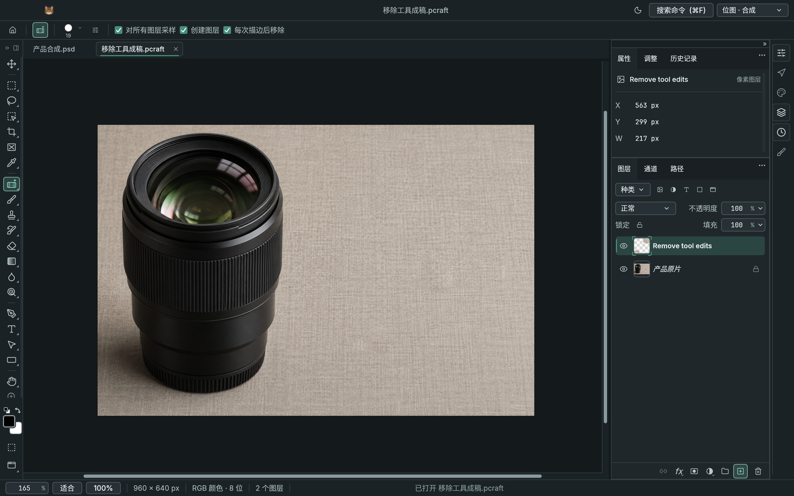
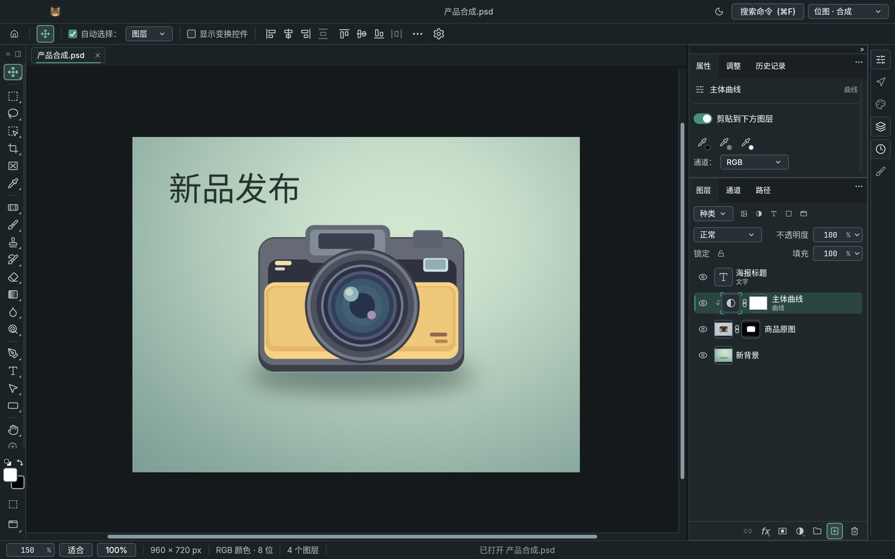

<p align="center">
  
</p>

<h1 align="center">P一下 · Mac端青春版Photoshop</h1>

<p align="center">
  在 Mac 上做日常修图、商品图合成和多尺寸出图。<br>
  圈掉杂物，改完标题，交付横幅、海报和方图。图层、蒙版与文字留在源稿里，改稿时还能继续编辑。
</p>

<p align="center">
  <a href="#产品截图">产品截图</a> ·
  <a href="#主要功能">主要功能</a> ·
  <a href="#项目介绍">项目介绍</a> ·
  <a href="#构建与部署">构建与部署</a>
</p>

## 产品截图



素材精修。画笔移除布面的纸屑和纤维，修复结果保存在独立图层。 [修复前后对照](docs/assets/remove-comparison.jpg) · [打开练习稿](examples/practice/移除工具练习.pcraft)



商品主图合成。样稿含可编辑中文标题、剪贴曲线和商品蒙版。 [打开分层样稿](examples/practice/产品合成.psd)

## 主要功能

| 功能 | 能做什么 |
| --- | --- |
| **修图与移除** | 用移除工具消除灰尘、纸屑和杂线。可合并应用多笔。内容识别填充支持自定义采样、预览和输出到新图层。 |
| **选区与蒙版** | 用选框、套索或色彩范围选中主体。把选区转成蒙版，换黑白背景检查半透明边缘，再在蒙版上继续修。 |
| **分层合成与调色** | 用图层、分组、混合模式组织画面。曲线可以剪贴到商品层，单独调整主体。替换智能对象内容时保留原有变换。 |
| **中文文字与排版** | 支持可编辑点文字和段落框。用系统中文字体改标题、调字重和换行，交付前可检查缺失字体。 |
| **画板与批量出图** | 用同一份源稿管理横幅、竖版海报与方图。批量导出 PNG、JPEG 或 WebP，也可从 CSV 批量替换画板的文案和商品图。 |
| **分层文件与素材交接** | 可用 `.pcraft` 继续改稿，也支持 PSD/PSB 分层读写。链接素材可检查、重链并打包。复杂 PSD 的文字版式和效果保真以交接实测为准。 |

[体验样稿](examples/) · [Mac 操作指南](docs/mac-guide.md) · [PSD 交接实测](docs/photoshop-coverage.md#photoshop-文字重算对照)

## 项目介绍

P一下基于 PhotoCraft 0.23.1 开发，面向平面设计、电商运营和需要日常修图的 Mac 用户。中文工作区按合成、精修和出图组织工具与面板，仓库同时提供可编辑样稿、交付脚本和逐项验收记录。

| 目录 | 内容 |
| --- | --- |
| [`app/`](app/) | Mac 启动器、工作区配置与动作预设 |
| [`tools/`](tools/) | 批量出图、CSV 套版、字体和链接检查、工程回归 |
| [`examples/`](examples/) | 可编辑练习稿、模板和 CSV 示例 |
| [`tests/evidence/`](tests/evidence/) | 分层验收成稿、参考图和回归记录 |
| [`docs/`](docs/) | 使用指南、功能验收与底座调研 |

[功能验收清单](docs/photoshop-coverage.md) · [PhotoCraft 源码与授权](https://github.com/storytold/photocraft/tree/v0.23.1)

## 构建与部署

可安装的 `P一下.app` 目前从 `codex/editor-ui` 界面预览分支构建。准备 Mac、Xcode 命令行工具和 Rustup，首次构建需要联网获取固定版本的源码、翻译、字体和依赖。

```sh
git clone --branch codex/editor-ui https://github.com/cooper-dev-404/p-yixia.git
cd p-yixia
rustup toolchain install 1.95.0 --profile minimal
bash app/editor-ui/build-macos.sh --install
```

安装后从访达的「应用程序」打开 `P一下.app`。构建脚本会生成当前 Mac 架构的本地签名应用，覆盖安装时保留上一版应用包。

想在仓库里先试用修图流程，可以执行 `bash app/P一下.command --remove`。这个入口使用同版本的官方 PhotoCraft 运行时，打开可以直接编辑和保存的练习副本。 [P一下构建与预览](https://github.com/cooper-dev-404/p-yixia/blob/codex/editor-ui/docs/mac-guide.md#编辑器界面预览) · [离线试用与工程回归](docs/mac-guide.md)
