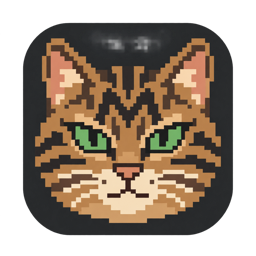
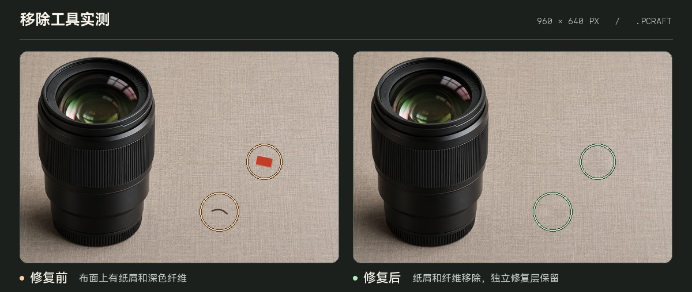

<p align="center">
  
</p>

<h1 align="center">P一下 · Pyixia</h1>

<p align="center"><strong>修好一张图，留好每一层。</strong></p>

<p align="center">
  P一下是一款面向 Mac 的位图编辑工作台。<br>
  修掉素材上的杂物，叠出一张商品主图，把同一份稿件交付成横幅、海报和方图。<br>
  修复层、蒙版和中文标题都能留在源稿里，重开还能接着改。
</p>

<p align="center">
  <a href="#在-mac-上试一张">在 Mac 上试一张</a> ·
  <a href="docs/mac-guide.md">使用指南</a> ·
  <a href="docs/photoshop-coverage.md">开发与验收</a>
</p>

<a href="tests/evidence/移除工具成稿.pcraft">
  
</a>

上图取自仓库里的练习稿与分层成稿。打开成稿，在图层面板关掉修复层，就能看回原片。

## 用一份样稿走一遍

| 想做什么 | 可以动手试什么 |
| --- | --- |
| **精修素材** | 圈掉纸屑，再涂掉布面上的纤维。两笔合并应用到一层，可以撤销，也可以单独调修复层的不透明度。 [移除工具练习](examples/practice/移除工具练习.pcraft) |
| **合成主图** | 在四层 PSD 里改中文标题，用剪贴曲线只调商品亮度，再在蒙版上继续修边。 [产品合成 PSD](examples/practice/产品合成.psd) |
| **批量交付** | 从同一份文档导出横竖版，也可以用 CSV 给多个画板批量换文案和商品图，逐组保留可编辑源稿。 [横竖版画板](examples/practice/横竖版交付.pcraft) · [CSV 套版样例](examples/templates/) |

## 在 Mac 上试一张

已安装 P一下时，从访达的「应用程序」打开 `P一下.app`。从仓库试用时，在根目录运行以下命令。

```sh
bash app/P一下.command --remove
```

仓库的试用入口会下载并校验 PhotoCraft 0.23.1 的官方通用运行时，打开可直接保存的独立练习副本。这个入口的窗口显示 PhotoCraft。用 `--fill` 打开内容识别填充练习，用 `--examples` 打开产品合成和多画板样稿。 [离线安装与操作步骤](docs/mac-guide.md)

## 从哪里找

| 目录 | 内容 |
| --- | --- |
| [`app/`](app/) | Mac 启动器、运行时安装脚本、默认工作区和动作预设 |
| [`tools/`](tools/) | 批量出图、CSV 套版、字体检查、链接素材打包与工程回归入口 |
| [`examples/`](examples/) | 可编辑练习稿和套版样例 |
| [`tests/evidence/`](tests/evidence/) | 验收成稿、参考图和回归记录 |
| [`docs/`](docs/) | Mac 操作指南、功能验收清单、引擎调研 |

P一下使用 PhotoCraft 0.23.1 作为编辑底座。当前可试用内容与 PSD 交接边界详见验收清单。可安装的 `P一下.app` 在界面预览分支独立验证。 [P一下应用构建说明](docs/mac-guide.md#编辑器界面预览) [上游源码与授权](https://github.com/storytold/photocraft/tree/v0.23.1) · [验收清单](docs/photoshop-coverage.md)
